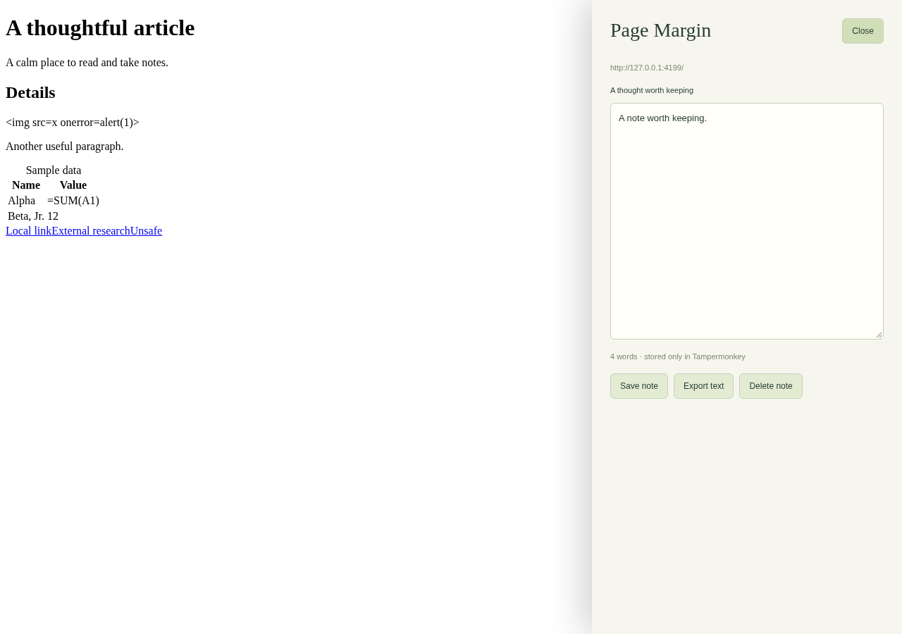

# Page Margin

Private page notes, opened only when you ask for them.

## Features

- One persistent note per site path using Tampermonkey storage
- Explicit save, delete, word counts, and text exports
- Query strings and fragments excluded from note identifiers
- Shadow DOM interface with keyboard dismissal

## Get started



1. Install **Tampermonkey** in a supported browser.
2. Open [`dist/page-margin.user.js`](dist/page-margin.user.js), select **Raw**, and accept the userscript manager’s installation prompt. Alternatively, paste the file into a new Tampermonkey script and save.
3. Visit an HTTPS page and open the Tampermonkey menu. Select the script’s command to activate it.

Nothing opens or changes page content until you choose the command. Use **Close** or **Escape** to dismiss the panel. The script matches HTTPS pages broadly because it is a general-purpose tool; you can narrow the `@match` metadata before installation if you prefer.

## Build and verify

Node.js 20+ is needed only for development. There are no package dependencies.

```sh
git clone https://github.com/oexwashere/page-margin.git
cd page-margin
npm run check
npm test
npm run build
```

The build combines `metadata.txt`, `src/core.js`, and `src/main.js` into a self-contained installable file in `dist/`. The generated artifact is committed so installation does not require Node. CI rebuilds and checks for drift.

Tests exercise the pure core functions. Browser checks were run in Chromium with simulated userscript APIs, covering activation, the main workflow, safe rendering, and dismissal. An actual Tampermonkey installation across arbitrary websites has **not** been verified; site-specific conflicts can still occur.

## Architecture

`src/core.js` contains the testable transformation logic. `src/main.js` contains menu registration, page extraction, and a shadow-root drawer. `metadata.txt` declares the exact userscript permissions. The script performs no analytics, external API calls, or automatic destination crawling.

Notes are keyed by origin and pathname, excluding query strings and fragments. Storage uses Tampermonkey’s isolated value APIs. UI content is constructed with DOM text nodes inside a shadow root.

## Limitations and data handling

Pages sharing a path but differing only by query or fragment share a note. Notes stay in the userscript manager and do not sync through this app. Stored notes are not encrypted. Opening a page or navigation can still trigger the original website’s own network requests.

## Contributing

See [CONTRIBUTING.md](CONTRIBUTING.md). Keep changes focused and include a regression test when behavior changes.

## License

[MIT](LICENSE) · oexwashere
